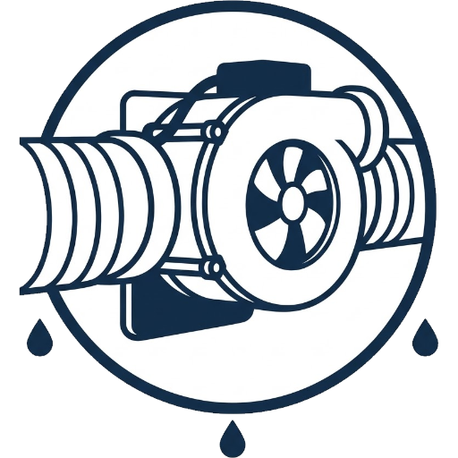

<p align="center">
  
</p>

<h1 align="center">Smart ventilation controller</h1>

<p align="center">
  Lüftet Keller und andere feuchte Räume nur dann, wenn es sie wirklich trockener macht.
</p>

<p align="center">
  <a href="https://github.com/hacs/integration"></a>
  <a href="https://github.com/berwil84afk/ha-smart-ventilation/releases"></a>
  
</p>

<p align="center">
  <a href="README.md">🇬🇧 English</a> · <b>🇩🇪 Deutsch</b>
</p>

---

## Warum diese Integration?

Wer einen feuchten Keller hat, lüftet oft nach Gefühl oder nach der **relativen** Luftfeuchtigkeit. Das geht schnell nach hinten los: Im Sommer zieht warme Außenluft durch das offene Fenster oder den Lüfter in den kühlen Keller. Dort kühlt sie ab, die relative Feuchte steigt, und an den kalten Wänden schlägt sich Wasser nieder. Der Keller wird durch das Lüften **feuchter statt trockener**.

Entscheidend ist nicht die relative, sondern die **absolute Luftfeuchtigkeit**: wie viel Gramm Wasser tatsächlich in einem Kubikmeter Luft stecken. Lüften trocknet nur, wenn die Außenluft weniger Wasser enthält als die Raumluft.

**Beispiel Sommer:**

| | Temperatur | relative Feuchte | absolute Feuchte |
|---|---|---|---|
| Außen | 25 °C | 60 % | **13,8 g/m³** |
| Keller | 16 °C | 75 % | **10,2 g/m³** |

Die relative Feuchte draußen ist niedriger, trotzdem bringt jeder Kubikmeter Außenluft rund 3,6 g Wasser **zusätzlich** in den Keller. Der Taupunkt der Außenluft liegt bei 16,7 °C, also über der Kellertemperatur: An den Wänden bildet sich Kondenswasser. → **Nicht lüften.**

**Beispiel Winter:**

| | Temperatur | relative Feuchte | absolute Feuchte |
|---|---|---|---|
| Außen | 2 °C | 90 % | **5,0 g/m³** |
| Keller | 14 °C | 70 % | **8,4 g/m³** |

Obwohl es draußen „nass“ aussieht, enthält die kalte Luft deutlich weniger Wasser. Jeder Kubikmeter Außenluft nimmt rund 3,4 g Feuchtigkeit aus dem Keller mit. → **Lüften lohnt sich.**

Genau diese Rechnung übernimmt der Smart ventilation controller, rund um die Uhr, und schaltet deinen Lüfter automatisch.

## Was die Integration macht

- **Schaltet nach absoluter Feuchte:** Der Lüfter läuft nur, wenn die Raumluft spürbar mehr Wasser enthält als die Außenluft. Ein- und Ausschaltschwelle sind getrennt (Hysterese), damit der Lüfter nicht ständig an und aus geht.
- **Schützt vor Kondenswasser:** Liegt der Taupunkt der Außenluft zu nah an der Wandtemperatur, bleibt der Lüfter aus. Ohne eigenen Wandsensor wird die Raumtemperatur als Näherung verwendet.
- **Lüftet nur bei Bedarf:** Unterhalb einer einstellbaren Mindestfeuchte im Raum wird nicht gelüftet, auch wenn die Außenluft trockener wäre.
- **Schont Lüfter und Raum:** Nach einer maximalen Laufzeit am Stück folgt eine Zwangspause. Die Pause übersteht auch einen Neustart von Home Assistant.
- **Optionale Nachtruhe:** In einem frei wählbaren Zeitfenster, auch über Mitternacht, bleibt der Lüfter aus.
- **Mehrere Lüfter:** Optional lassen sich weitere Lüfter hinzufügen, z. B. für Zu- und Abluft. Sie werden immer gemeinsam mit dem Hauptlüfter geschaltet.
- **Batteriebetrieb:** Läuft der Lüfter an einem Akku oder einer Powerstation, achtet die Steuerung auf den Ladezustand und schaltet unterhalb einer einstellbaren Grenze nicht mehr ein.
- **Ignoriert Messfehler:** Nicht verfügbare Sensoren oder unplausible Werte (z. B. 0 % Feuchte bei Wetterstationen) führen nicht zu Fehlschaltungen.
- **Macht die Werte sichtbar:** Absolute Feuchte innen und außen, Differenz, Taupunkte, Laufzeit und ein verständlicher Statustext stehen als Sensoren mit Verlauf zur Verfügung.
- **Benachrichtigt auf Wunsch:** Über Notify-Entitäten (z. B. Telegram) oder klassische Notify-Dienste (z. B. Companion App), pro Ereignis wählbar.
- **Komplett über die Oberfläche:** Kein YAML, keine Helfer, keine Vorlagen. Mehrere Räume lassen sich unabhängig voneinander einrichten.

## Was du brauchst

- Home Assistant **2024.12** oder neuer
- Einen **Temperatur-** und einen **Feuchtesensor im Raum**
- Einen **Temperatur-** und einen **Feuchtesensor außen** (z. B. Wetterstation)
- Mindestens einen schaltbaren **Lüfter**: `switch`, `fan`, `light` oder `input_boolean` (z. B. ein Rohrlüfter an einer smarten Steckdose); weitere Lüfter sind optional
- Optional: einen Sensor für die **Wandtemperatur**, für einen genaueren Kondensationsschutz
- Bei Batteriebetrieb: einen Sensor mit dem **Ladezustand** in %

## Installation

### Über HACS (empfohlen)

[](https://my.home-assistant.io/redirect/hacs_repository/?owner=berwil84afk&repository=ha-smart-ventilation&category=integration)

Oder von Hand:

1. In HACS oben rechts auf **⋮ → Benutzerdefinierte Repositories** gehen.
2. `https://github.com/berwil84afk/ha-smart-ventilation` eintragen, Typ **Integration**.
3. **Smart ventilation controller** herunterladen und Home Assistant neu starten.

### Manuell

1. Den Ordner `custom_components/smart_ventilation_controller` nach `/config/custom_components/` kopieren.
2. Home Assistant neu starten.

## Einrichtung

[](https://my.home-assistant.io/redirect/config_flow_start/?domain=smart_ventilation_controller)

Oder: *Einstellungen → Geräte & Dienste → Integration hinzufügen → Smart ventilation controller*.

1. **Name** vergeben, z. B. „Keller“. Er bestimmt die Namen der Entitäten, z. B. `sensor.keller_status`.
2. **Sensoren** für innen und außen auswählen, optional einen Wandtemperatur-Sensor.
3. **Lüfter** auswählen, optional unter „Weitere Lüfter“ zusätzliche Lüfter, die gemeinsam mitgeschaltet werden.
4. **Stromquelle** wählen: „Stromnetz“ (Standard) oder „Batterie“. Bei Batterie zusätzlich den **Ladezustand**-Sensor auswählen. Beides lässt sich später unter **Konfigurieren** ändern.

Fertig. Die Steuerung läuft sofort mit sinnvollen Standardwerten.

Für jeden weiteren Raum die Integration einfach erneut hinzufügen. Sensoren oder Lüfter lassen sich später über **⋮ → Neu konfigurieren** tauschen.

## Einstellungen

### Schwellwerte (direkt im Dashboard)

Die Schwellwerte sind eigene Entitäten des Geräts und lassen sich jederzeit im Dashboard ändern:

| Entität | Standard | Bedeutung |
|---|---|---|
| Einschalt-Puffer | 2,5 g/m³ | So viel mehr Wasser muss die Raumluft enthalten, damit der Lüfter einschaltet |
| Ausschalt-Puffer | 1,0 g/m³ | Fällt die Differenz darunter, schaltet der Lüfter wieder aus |
| Taupunkt-Sicherheitsabstand | 2 °C | So weit muss der Taupunkt außen unter der Wandtemperatur liegen |
| Mindestfeuchte innen | 55 % | Darunter wird nicht gelüftet |
| Mindest-Ladezustand | 20 % | Nur bei Batterie: darunter wird nicht eingeschaltet und ein laufender Lüfter ausgeschaltet; wieder frei ab Grenze + 5 % |

### Optionen (über „Konfigurieren“)

| Option | Standard | Bedeutung |
|---|---|---|
| Stromquelle | Stromnetz | „Stromnetz“ oder „Batterie“ |
| Ladezustand | – | Nur bei Batterie: Sensor mit dem Ladezustand in % (Pflicht) |
| Maximale Laufzeit am Stück | 60 min | Danach Zwangspause; 0 = unbegrenzt |
| Zwangspause | 60 min | Mindestpause nach der Maximallaufzeit; 0 = keine Pause |
| Nachtruhe aktivieren | aus | Schaltet den Lüfter im gewählten Zeitfenster ab |
| Nachtruhe von / bis | 00:00 / 06:00 | Auch über Mitternacht möglich, z. B. 22:00–06:00 |
| Notify-Entitäten | – | z. B. `notify.telegram_bot_…` |
| Notify-Dienste | – | z. B. `mobile_app_handy` |
| Benachrichtigen bei | ein, aus, Pause, Nachtruhe, niedriger Ladezustand | Zusätzlich wählbar: Lüften wegen Kondensationsgefahr verhindert |

Ohne Notify-Ziel werden keine Nachrichten verschickt.

## Entitäten

Die Namen der Entitäten folgen der Sprache von Home Assistant (Deutsch oder Englisch). Beispiel für einen Eintrag mit dem Namen „Keller“ in einer deutschen Installation:

| Entität | Beschreibung |
|---|---|
| `sensor.keller_status` | Statustext, z. B. „🟢 Aktiv – Lüftung läuft (Diff 3,1 g/m³)“; das Attribut `code` eignet sich für eigene Automationen |
| `sensor.keller_absolute_feuchte_innen` | Absolute Feuchte im Raum (g/m³) |
| `sensor.keller_absolute_feuchte_aussen` | Absolute Feuchte außen (g/m³) |
| `sensor.keller_feuchtedifferenz` | Innen minus außen (g/m³) |
| `sensor.keller_taupunkt_innen` | Taupunkt im Raum (°C) |
| `sensor.keller_taupunkt_aussen` | Taupunkt außen (°C) |
| `sensor.keller_laufzeit` | Aktuelle Laufzeit des Lüfters (min); bei mehreren Lüftern seit dem ersten Einschalten |
| `sensor.keller_pause_bis` | Ende der Zwangspause |
| `binary_sensor.keller_luften_sinnvoll` | An, wenn alle Bedingungen zum Lüften erfüllt sind |
| `binary_sensor.keller_kondensationsgefahr` | An, wenn Lüften zu Kondenswasser führen könnte |
| `binary_sensor.keller_nachtruhe` | An, während die Nachtruhe aktiv ist |
| `binary_sensor.keller_zwangspause` | An, während der Zwangspause |
| `switch.keller_automatik` | Steuerung an/aus; beim Ausschalten bleibt der Lüfter im aktuellen Zustand |
| `binary_sensor.keller_ladezustand_zu_niedrig` | Nur bei Batterie: an, solange der Ladezustand das Lüften sperrt |
| `number.keller_…` | Die Schwellwerte (siehe oben); „Mindest-Ladezustand“ nur bei Batterie |

Schwellwerte, Automatik-Status und eine laufende Pause bleiben über Neustarts erhalten.

Auch Statustexte und Benachrichtigungen folgen der Sprache von Home Assistant: Deutsch bei deutscher Installation, sonst Englisch. Das Attribut `code` des Status-Sensors ist sprachunabhängig.

## So entscheidet die Steuerung

Sind mehrere Lüfter eingerichtet, gelten sie als Gruppe: „läuft“, sobald einer von ihnen an ist, und geschaltet werden immer alle erreichbaren Lüfter gemeinsam. Ein einzelner nicht erreichbarer Lüfter blockiert die Steuerung der übrigen nicht.

Die Integration wertet bei jeder Änderung der Sensoren und zusätzlich jede Minute aus, in dieser Reihenfolge:

1. **Lüfter nicht erreichbar** oder **Automatik aus** → nichts tun.
2. **Nachtruhe aktiv** → Lüfter aus und nicht einschalten.
3. **Maximale Laufzeit erreicht** → Lüfter aus, Zwangspause starten.
4. **Nur bei Batterie:**
   - Ladezustand unter der Grenze → Lüfter aus und nicht einschalten. Freigabe erst wieder ab Grenze + 5 %, damit der Lüfter nicht ständig an- und ausgeht.
   - Ladezustand unbekannt → nicht einschalten; ein laufender Lüfter wird normal weitergesteuert.
5. **Messwerte ungültig** → nichts schalten.
6. **Lüfter läuft** → ausschalten, sobald
   - die Feuchte innen unter die Mindestfeuchte fällt, **oder**
   - die Differenz unter den Ausschalt-Puffer fällt, **oder**
   - der Taupunkt außen die Wandtemperatur erreicht.
7. **Lüfter steht** → einschalten, wenn
   - keine Zwangspause läuft, **und**
   - die Feuchte innen mindestens der Mindestfeuchte entspricht, **und**
   - die Differenz größer als der Einschalt-Puffer ist, **und**
   - der Taupunkt außen mindestens um den Sicherheitsabstand unter der Wandtemperatur liegt.

Die absolute Feuchte und der Taupunkt werden mit der Magnus-Formel berechnet. Temperaturen in °F oder K werden automatisch umgerechnet.

## Beispiele

### Dashboard-Karte

```yaml
type: entities
title: Kellerlüftung
entities:
  - entity: sensor.keller_status
  - entity: switch.keller_automatik
  - entity: sensor.keller_absolute_feuchte_innen
  - entity: sensor.keller_absolute_feuchte_aussen
  - entity: sensor.keller_feuchtedifferenz
  - entity: binary_sensor.keller_kondensationsgefahr
  - entity: sensor.keller_laufzeit
```

### Eigene Benachrichtigung mit dem Status-Code

Wer Nachrichten an unterschiedliche Empfänger schicken möchte, lässt die Benachrichtigungen der Integration leer und reagiert stattdessen auf das Attribut `code` des Status-Sensors:

```yaml
alias: Kellerlüftung – Nachtruhe melden
triggers:
  - trigger: state
    entity_id: sensor.keller_status
    attribute: code
    to: night
actions:
  - action: notify.send_message
    target:
      entity_id: notify.telegram_familie
    data:
      message: "🌙 Kellerlüftung pausiert für die Nachtruhe."
```

Mögliche Codes: `running`, `off`, `pause`, `night`, `difference_low`, `min_humidity`, `condensation`, `invalid`, `disabled`, `fan_unavailable`, `battery_low`, `battery_unknown`, `error`.

## Icon

Das eigene Integrations-Icon wird ab Home Assistant **2026.3** angezeigt, im dunklen Design in einer hellen Variante. Ältere Versionen zeigen ein Platzhalter-Icon; die Funktion ist davon nicht betroffen.

## Fehler und Wünsche

Fehler oder Ideen bitte als [Issue](https://github.com/berwil84afk/ha-smart-ventilation/issues) melden. Hilfreich sind dabei die Home-Assistant-Version und die Meldungen aus dem Protokoll (*Einstellungen → System → Protokolle*).

## Lizenz

Veröffentlicht unter der [MIT-Lizenz](LICENSE).
